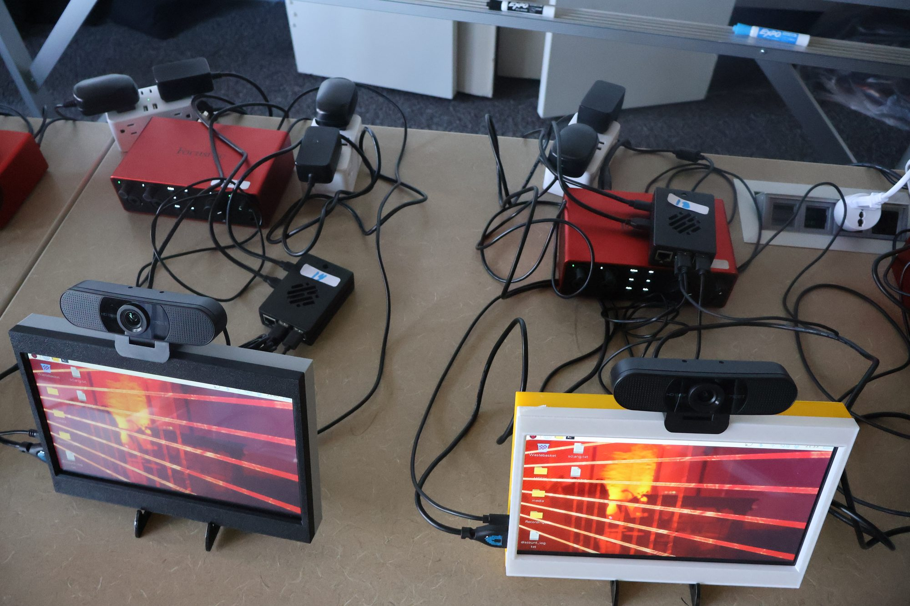
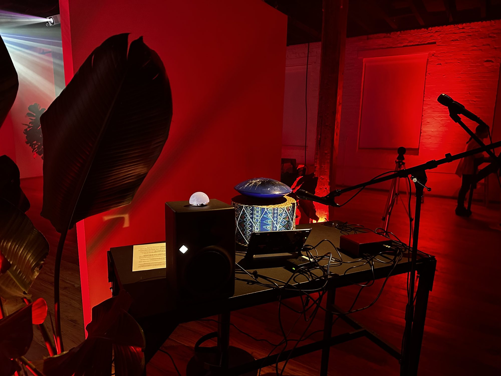
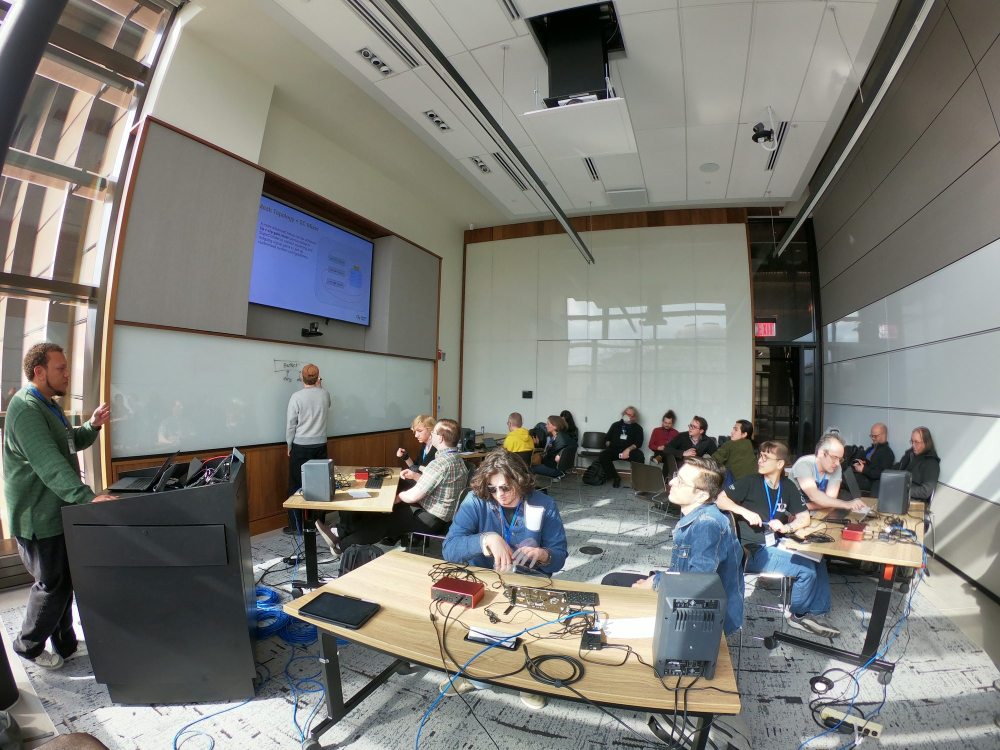
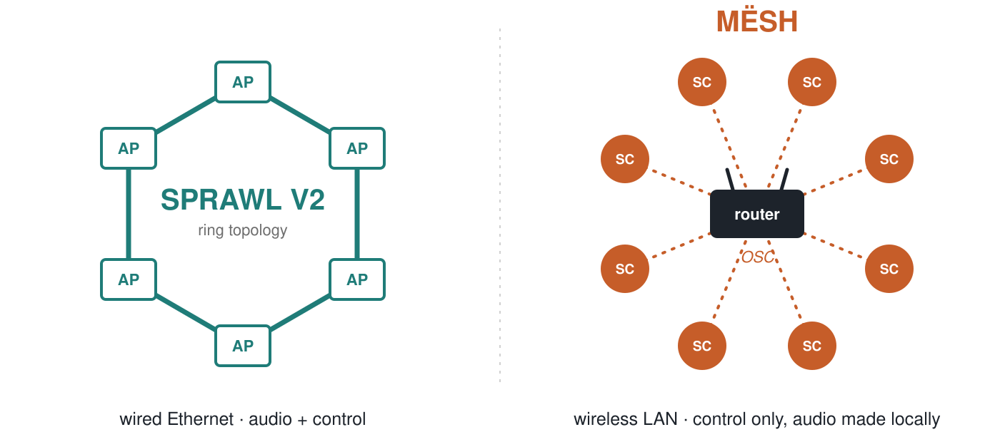
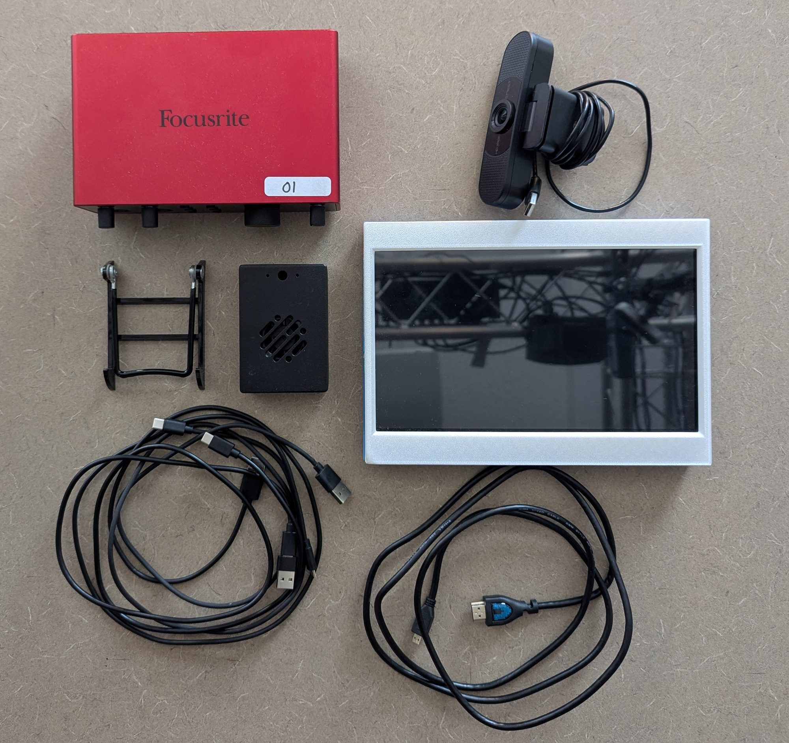
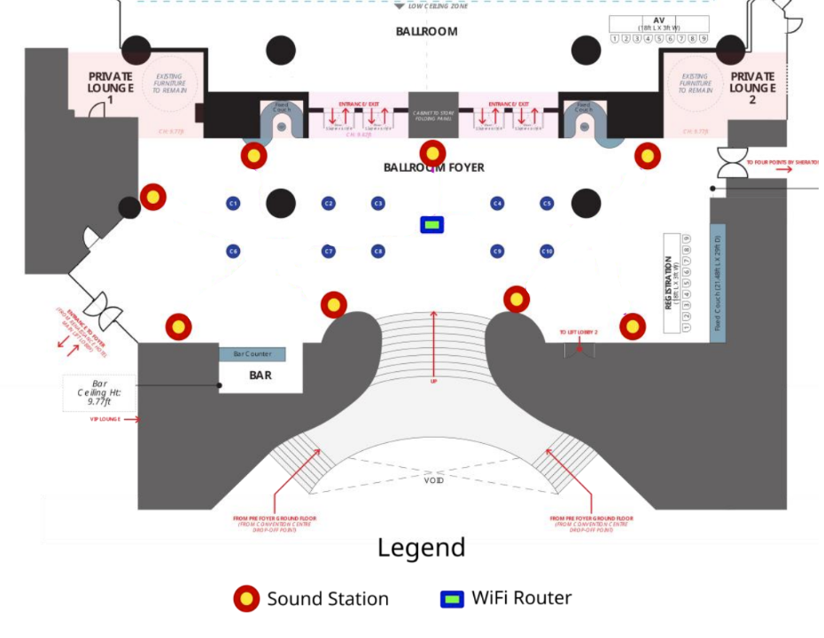
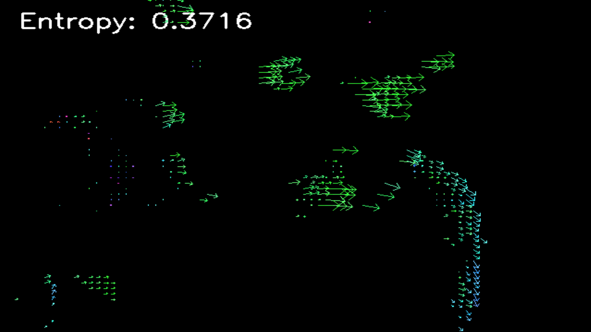
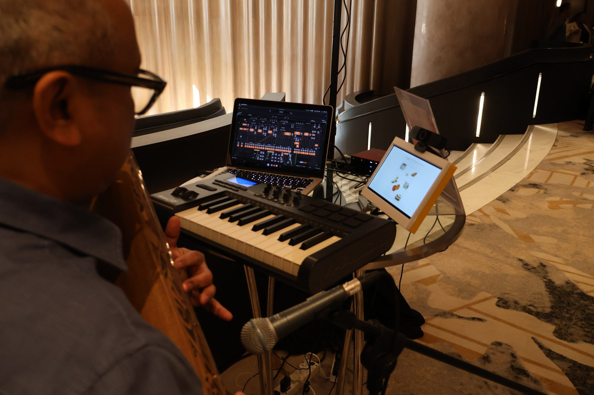
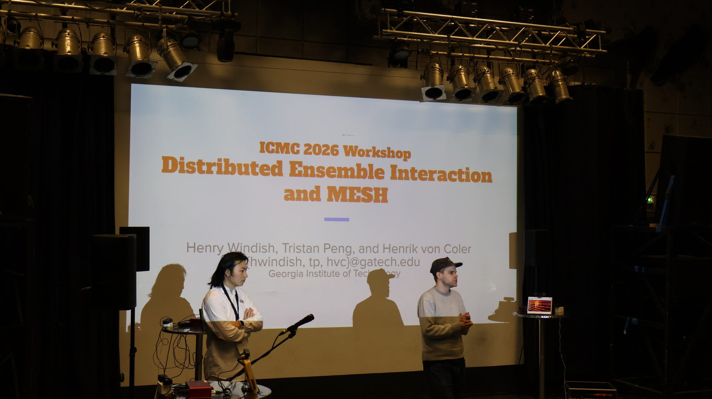
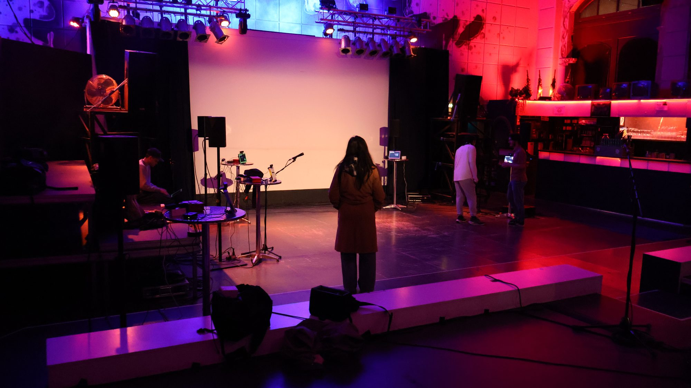

# Why distributed ensembles? {background-image="pictures/many_pi_screens.jpg" background-opacity="0.45"}

## Distributed systems open up the ensemble

:::: {.columns}
::: {.column width="55%"}
- Sound comes **from the space**, not from a PA
- Richer interaction between performers
- Scores and instructions sent in **real time**
- The audience can take part
:::
::: {.column width="45%"}
{.photo .ph fig-alt="Two MËSH nodes with touchscreens"}
:::
::::

::: prose
Distributed music systems change how sound, control and interaction are organised across performers and spaces. The first advantage is physical: a distributed ensemble adapts to the space and allows configurations a classic PA cannot produce. It also widens the range of interaction between musicians, supports real-time distribution of scores and performance instructions for adaptive or algorithmic compositions, and opens the door to audience participation, turning listeners into contributors.
:::

## The catch: infrastructure

- Central servers, multichannel routing, networking between all performers
- **Wired** Ethernet: reliable and low-latency, but…
  - cabling grows with ensemble size
  - cables pin performers in place
  - setup in unfamiliar venues takes long
- Result: fewer rehearsals, harder touring

::: prose
These systems usually need complex infrastructure. Setup time is substantial, and transporting and configuring specialised equipment limits rehearsal, touring and performance in varied venues. Wired networking is a particular constraint: Ethernet gives reliable, low-latency communication, but cabling grows with the ensemble, constrains where performers can stand, and complicates setup in temporary spaces.

MËSH is our answer: a portable ensemble system built around a wireless LAN and a streamlined, automated setup workflow.
:::

## From SPRAWL to MËSH

::: column-page

:::

::: prose
The path covered in this talk: from the original, server-based SPRAWL [@voncoler2020sprawl], through the ring-based SPRAWL V2 and two deployments that exposed its touring overhead, to the wireless MËSH system and its first two international deployments.
:::

## Related work

:::: {.columns .smaller-text}
::: {.column width="50%"}
**Networked ensembles**

- The Hub, 1980s–90s [@HUBintro]
- PLOrk, SLOrk: laptop + speaker meta-instruments [@PLorkYear1; @slork]
- L2Ork: open source, flexible setups [@nime2010_Bukvic_linux]
- HELO: heterogeneous hardware and software [@helo]
:::
::: {.column width="50%"}
**Networked music performance**

- Latency and synchronisation [@rottondiNMP; @chafe2010effect]
- JackTrip: uncompressed audio streaming [@caceres2010jacktrip]
- Telematic performance as a medium [@telematic]
- Internet of Musical Things [@turchet2018iomust]
:::
::::

::: prose
The Hub pioneered real-time exchange of control data between networked performers. Laptop orchestras such as PLOrk and SLOrk standardised "meta-instruments" of laptop, speaker and controller; L2Ork extended the model with open-source software and flexible configurations, while HELO embraced heterogeneous hardware and software. Networked music performance research has focused on latency, synchronisation and audio quality, with JackTrip widely used for uncompressed streaming, and artistic work treating telematic constraints as compositional material. Work on wireless installations and the Internet of Musical Things points toward low-cost, decentralised devices, which is the direction MËSH takes: portability, minimal infrastructure and adaptable deployment.
:::

# SPRAWL V2: the wired predecessor {background-image="pictures/goat_farm.jpeg" background-opacity="0.45"}

## SPRAWL → SPRAWL V2

:::: {.columns}
::: {.column width="50%"}
**SPRAWL** (2019/20)

- Central server: routing, mixing, spatialisation
- Access points on a wired LAN
- Control via OSC [@wright2003opensound]
:::
::: {.column width="50%" .fragment}
**SPRAWL V2** (2023)

- New hardware, **no central server**
- Access points in a **ring**
- Stable and low latency, but every link is a cable
:::
::::

::: prose
The original SPRAWL used a client–server architecture: a central server handled audio routing, mixing and spatialisation, and performers connected through access points on a wired LAN. Audio from each access point went to the server, was processed and redistributed to the other performers and the spatialisation system, while OSC handled control such as levels, routing and spatialisation. In 2023, SPRAWL V2 updated the hardware and removed the central server, connecting the access points in a ring. That is stable and low-latency, but it still depends on wired connections between all components.
:::

## Goat Farm Arts Center, Atlanta · Fall 2024

:::: {.columns}
::: {.column width="40%"}
- **12** access points, one musician each
- Student-built SPRAWL V2 programs
  - spatialised granular synthesis
  - graphic scores for audience and players
- Some access points open to the audience
:::
::: {.column width="60%"}
{.photo .ph}
:::
::::

::: prose
In fall 2024 SPRAWL V2 was used at The Goat Farm Arts Center in Atlanta. Twelve access points were set up, each with a musician playing their own instrument into the system. The concert consisted of student-created programs ranging from real-time spatialised granular synthesis to a graphic score visible to audience and musicians. At the access point shown, the drum is picked up by a microphone into the audio interface and fed into the system; other access points let the audience play along.
:::

## SuperCollider Symposium, DC · Spring 2025

:::: {.columns}
::: {.column width="55%"}
{.photo .ph}
:::
::: {.column width="45%"}
- Workshop: techniques for distributed systems
- Ring topology; attendees designed the processing for their access point
- **4 access points**
- **10-hour drive** in a midsize car

::: {.fragment}
→ this is what we set out to fix
:::
:::
::::

::: prose
After being taught in the classroom in fall 2024, SPRAWL V2 went to Washington, DC in spring 2025 for a workshop at the SuperCollider Symposium. The workshop covered techniques for working with SPRAWL V2 and, more generally, with distributed performance systems; attendees designed the audio processing for their own access point in the ring. Bringing just four access points meant a ten-hour drive from Atlanta in a midsize vehicle. That trip motivated MËSH.
:::

# The MËSH system {background-image="pictures/mesh_build_in_progress.jpg" background-opacity="0.45"}

## Design goals

- **Portable**: compact, self-contained nodes
- **Wireless**: no audio or Ethernet runs between nodes
- **Decentralised**: every node is an independent sound source *and* part of the whole
- **Fast to deploy**: one automated workflow for every venue

::: prose
MËSH is a distributed performance infrastructure that puts portability, efficiency and flexibility first without giving up expressive range. Each node integrates computation, audio I/O and control in one unit, avoiding racks and central equipment. Instead of analog or digital audio runs, nodes communicate over a network, which makes setup simpler and lets nodes go almost anywhere: unconventional stage layouts, audience-distributed configurations or site-specific installations.
:::

## Architecture: control travels, audio stays local

{width="100%" fig-alt="Left: SPRAWL V2 access points wired in a ring carrying audio and control. Right: eight MËSH nodes connected wirelessly to a central router, exchanging OSC control data only."}

::: prose
MËSH runs on a dedicated wireless network. Each node is both an independent sound source and part of a coordinated system. Control data (timing, parameter changes, interaction events) is sent as OSC. The current implementation does **not** stream audio between nodes: each node generates and processes sound locally. This keeps bandwidth low, simplifies network configuration and makes the system robust on Wi-Fi, where low-latency, high-quality audio streams are hard to maintain. Audio streaming is a topic for future versions.
:::

## Hardware: one node

:::: {.columns}
::: {.column width="45%"}
{.photo .ph fig-alt="Hardware for one MËSH node"}
:::
::: {.column width="55%"}
- Raspberry Pi 5
- 10.1″ ROADOM touchscreen
- Focusrite Scarlett 2i2
- EMEET C960 webcam (installations)
- Powered speaker, supplied by the venue
- One dedicated router for all nodes

::: {.fragment}
**Video nodes**: Beelink S12 Mini, Ubuntu 24.04. OSC in, generative visuals (Processing) and graphic scores out.
:::
:::
::::

::: prose
Each node is built around a Raspberry Pi 5 with a 10.1-inch ROADOM touchscreen for local control and visualisation and a Focusrite Scarlett 2i2 audio interface. All nodes are networked through one dedicated router; a powered loudspeaker, usually supplied by the venue, sits with each node. For installations, EMEET C960 webcams at each node enable audience interaction. Video nodes are Beelink S12 Mini PCs running Ubuntu 24.04 LTS on the same network: they receive OSC and turn it into generative visuals, often in Processing, and also display graphic scores.
:::

## Software

- Debian 13 "Trixie" on every node
- **SuperCollider** per node: local synthesis, networked control
- **OSC** between nodes
- **OpenCV** + webcam for audience interaction [@opencv_library]
- **Ansible** for deployment [@ansible]

::: {.fragment}
> A piece is an Ansible playbook: one command configures every audio and video node.
:::

::: prose
All nodes run Debian 13 "Trixie". SuperCollider runs independently on each node, so audio is generated locally while the node responds to networked control messages over OSC. OpenCV analyses webcam video in real time; the results can be mapped to musical parameters or drive visuals on the video nodes. Deployment and maintenance are automated with Ansible: configuration, updates and system management happen on all nodes at once, and pieces and installations are themselves Ansible playbooks that configure every node in one step. This keeps the system consistent and setup short.
:::

# On the road {background-image="pictures/mesh_in_cases.jpeg" background-opacity="0.35"}

## Kuala Lumpur · Fall 2025

:::: {.columns}
::: {.column width="40%"}
{.photo .ph}
:::
::: {.column width="60%"}
Convergence Innovation Competition Asia

::: {.bignums}

<b>8</b>nodes

<b>3</b>road cases

<b>2</b>people

<b>2 h</b>setup + soundcheck

:::

- Flown as standard checked luggage
- Only the speakers came from the venue
- Setup fully automated with Ansible
:::
::::

::: prose
In fall 2025 MËSH was presented at the Convergence Innovation Competition Asia in Kuala Lumpur, a practical test of portability, setup and flexibility. An eight-node system travelled as standard checked luggage, with all node and networking equipment in three Gator road cases. Everything fit except the speakers, which the venue supplied. That is a significant reduction in logistics compared with SPRAWL. On site, setup meant powering the router and nodes, bringing up the wireless network and initialising audio and control, all automated with Ansible. Two people set up and soundchecked the system in two hours.
:::

## Kuala Lumpur: installation

:::: {.columns}
::: {.column width="45%"}
{.photo .ph}
:::
::: {.column width="55%"}
- A camera at every node
- OpenCV: total pixel motion as a proxy for movement
- Shared over OSC → SuperCollider sound field
- Screens show the motion field back to visitors

{.photo fig-alt="Motion visualisation on a node screen" style="max-height:230px; width:auto"}
:::
::::

::: prose
Without cables, nodes could be placed freely through the space. In installation mode, visitors interacted through a camera at each node. A Python/OpenCV script tracked total pixel movement as a proxy for people moving through the room; each node's data was shared over OSC and used as control data for a SuperCollider sound field. Each touchscreen showed the direction every pixel moved between frames, inviting visitors to find out how their active and passive movement changed the sound field.
:::

## Kuala Lumpur: performance

:::: {.columns}
::: {.column width="58%"}
{.photo .ph}
:::
::: {.column width="42%"}
- Graphic score [*DISCOUNT*](https://hvc.berlin/discount/) deployed to all nodes via Ansible
- Players read the score on their node
- Video nodes show it to the audience
- Performers spread through the room
:::
::::

::: prose
In performance mode, MËSH supported a networked ensemble in which performers controlled their own audio streams. The graphic score *DISCOUNT* was deployed to all nodes simultaneously with Ansible: musicians read it on the touchscreen at their node while the video nodes displayed it for the audience. Wireless connectivity let performers, and the sound, fill the room.
:::

## ICMC Hamburg · Spring 2026

:::: {.columns}
::: {.column width="50%"}
{.photo .ph style="max-height:300px"}

{.photo .ph style="max-height:300px"}
:::
::: {.column width="50%"}
- Again: 3 cases, venue speakers, **2 people · 2 h**
- **Workshop** (1 h): four guided demos with prediction tasks and discussion
- **Installation**: reworked sound design, lighter visuals
  - ran autonomously for **8 hours**
  - ~**100** visitors
:::
::::

::: prose
For the International Computer Music Conference in Hamburg in spring 2026 the system again travelled in three road cases, with speakers provided by the conference, and again took two people two hours to set up and soundcheck in an unfamiliar venue. The one-hour workshop introduced participants to MËSH hands-on: four guided demonstrations, each paired with prediction activities, discussion and exercises on system behaviour, use cases and trade-offs, ending with a discussion of how MËSH-type systems could fit participants' own work. The installation reworked the Kuala Lumpur piece with new sound design and more efficient visuals; it ran autonomously for eight hours and was visited by roughly 100 members of the ICMC community.
:::

# Wrapping up

## SPRAWL V2 vs. MËSH

| | SPRAWL V2 | MËSH |
|---|---|---|
| Network | Wired Ethernet, ring | Dedicated wireless LAN |
| Between units | Audio + control | Control only (OSC) |
| Sound generation | Over the network | Locally on each node |
| Deployment | Per access point | Ansible playbook for all nodes |
| On the road | 4 access points, 10 h by car | 8 nodes in 3 cases, checked luggage |

::: prose
Compared with SPRAWL V2, MËSH trades networked audio for local synthesis and wireless control. In return it fits in checked luggage, sets up in two hours with two people, and places nodes wherever the space suggests.
:::

## Conclusions & next steps

- Self-contained nodes + wireless OSC + Ansible = **minimal infrastructure**
- Proven abroad twice: installation, ensemble performance, workshop
- Suited to touring, site-specific work, participatory installations

::: {.fragment}
**Next**

- Wireless **audio streaming** between nodes
- **Laptop nodes** instead of Raspberry Pis
:::

::: prose
By distributing computation, sound generation and control across self-contained nodes, MËSH gives a scalable, spatially flexible performance environment without central infrastructure or extensive cabling. Wireless communication, OSC control and automated deployment with Ansible cut setup time while keeping the expressive range of distributed electroacoustic performance. The deployments in Kuala Lumpur and Hamburg showed the system can be transported, configured and run in new environments with little logistical overhead, for both installations and ensemble performance. Next, we will explore wireless audio streaming between nodes and look at moving from Raspberry Pi to laptop nodes to generalise the hardware. More broadly, MËSH points toward lightweight, decentralised approaches in electroacoustic music systems.
:::

## Thank you {.center}

**Henry Windish · Henrik von Coler** 
Georgia Institute of Technology

[github.com/L42i/MËSH](https://github.com/L42i/MËSH)

::: slides-only
Slides and full text: *add your published URL here*
:::

## References {.smaller-text .scrollable}

::: {#refs}
:::
